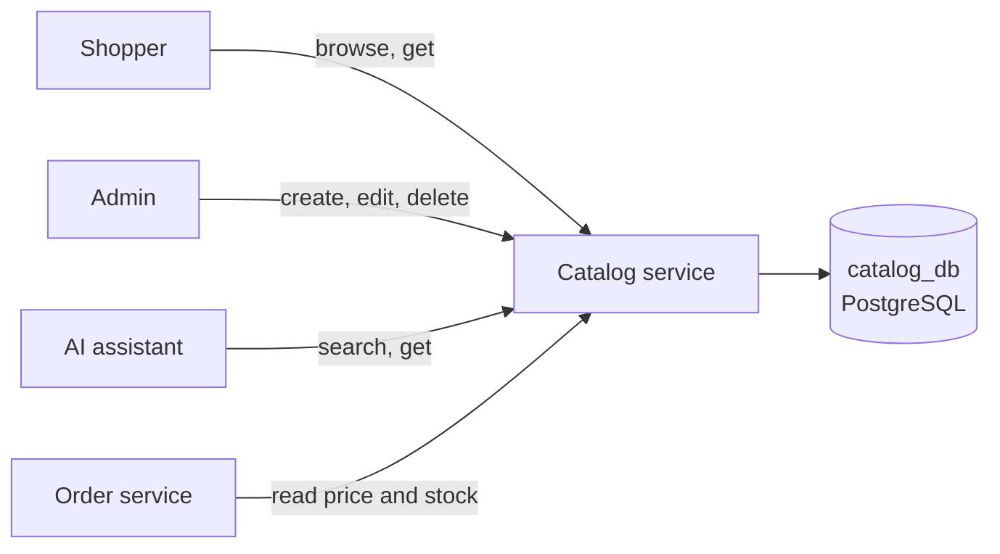
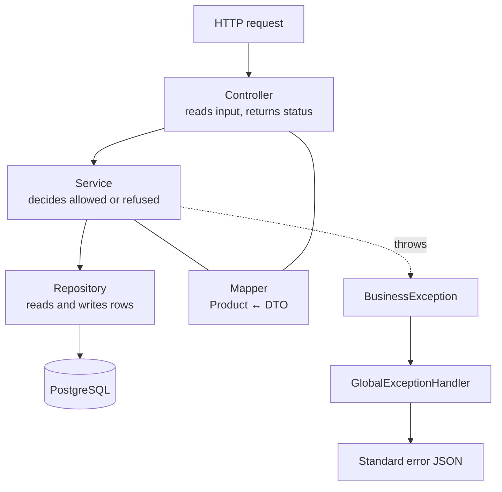
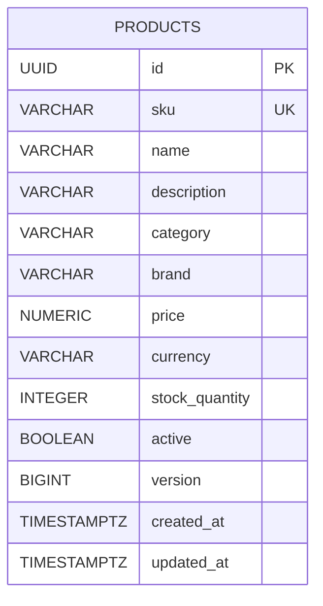
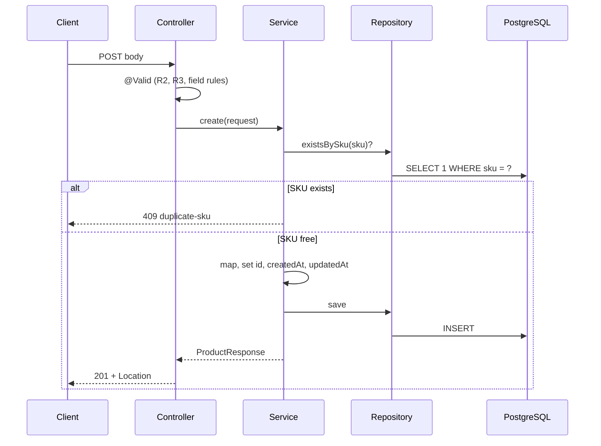
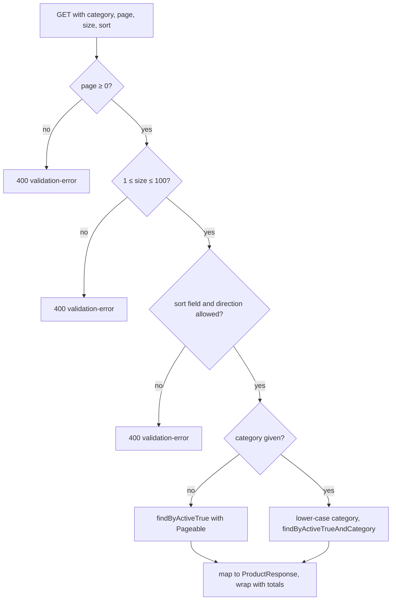
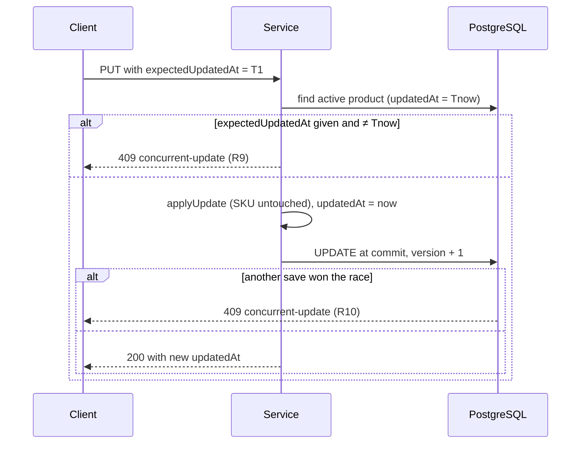

# Catalog Service: Complete Guide

This document describes the catalog service end to end: what it owns, how a request moves through it,
the data it stores, every rule it enforces, every endpoint, how it is configured and tested, and what is still missing.

Read this with [CONCEPTS.md](CONCEPTS.md), which explains the general ideas used here.

Status: ✅ built and merged · 🟡 built on a branch, not yet merged · ⬜ planned

---

## 1. Purpose and boundaries

### 1.1 What the catalog service owns

The catalog is the source of truth for **products**: what exists, what it costs, how many are in stock, and whether it is on sale.

| Owns (decides) | Does not own (asks someone else) |
|---|---|
| Product identity (`id`, `sku`) | Customer identity (auth service, later) |
| Name, description, category, brand | Prices charged to a customer (order service, later) |
| Price and currency | Stock reservation during checkout (inventory service, later) |
| Stock quantity as recorded in the catalogue | Order status (order service, later) |
| Soft-delete state (`active`) | AI answers (assistant service, later) |

**Reason for the boundary:** if the catalog also decided orders or stock reservations, a change to checkout would force a change to the catalog. Keeping each service to one area lets teams change them independently.

### 1.2 Scope diagram



---

## 2. Architecture

### 2.1 Package map

```
com.auramart.catalog
├── CatalogServiceApplication   starts Spring, scans com.auramart.catalog and com.auramart.common
├── controller/ProductController HTTP endpoints under /api/v1/products
├── service/ProductService       business rules, transactions
├── repository/ProductRepository database queries, written as method names
├── domain/Product               the stored row (JPA entity)
├── dto/ProductRequest           input shape, with validation rules
├── dto/ProductResponse          output shape, hides internal fields
├── dto/PagedResponse            page wrapper used by the list endpoint
└── mapper/ProductMapper         converts between Product and the DTOs
```

Shared code from `common-lib`: `BusinessException`, `GlobalExceptionHandler`, `RequestIdFilter`.

### 2.2 Layers and their rule



**Rule:** a layer only calls the layer directly below it. The controller never calls the repository.
**Why:** each rule has exactly one place to be changed, and each layer can be tested alone.

---

## 3. Data model

### 3.1 The `products` table

Created by `V1__create_products.sql`, with `currency` corrected by `V2__currency_as_varchar.sql`.

| Migration | What it does |
|---|---|
| `V1__create_products.sql` | The `products` table |
| `V2__currency_as_varchar.sql` | `currency` from `CHAR(3)` to `VARCHAR(3)`, to match the entity |
| `V3__trigram_search.sql` | `pg_trgm` extension and a GIN trigram index on `name` |
| `V4__trigram_search_brand_category.sql` | GIN trigram indexes on `brand` and `category` |
| `V5__list_indexes.sql` | Partial indexes `WHERE active` for the list endpoint, measured with `EXPLAIN ANALYZE` |

| Column | Type | Constraint | Why |
|---|---|---|---|
| `id` | UUID | primary key | Created by the service, so the ID is known before the save |
| `sku` | VARCHAR(64) | NOT NULL, UNIQUE | Business identifier; uniqueness is the database's final guarantee |
| `name` | VARCHAR(200) | NOT NULL | Shown to shoppers |
| `description` | VARCHAR(4000) | NOT NULL | Product details |
| `category` | VARCHAR(80) | NOT NULL | Stored lower-case, used for filtering |
| `brand` | VARCHAR(80) | nullable | Not every product has one |
| `price` | NUMERIC(10,2) | NOT NULL | Exact decimal; never a floating-point type for money |
| `currency` | VARCHAR(3) | NOT NULL | ISO code, stored upper-case (V2 changed it from CHAR) |
| `stock_quantity` | INTEGER | NOT NULL, CHECK ≥ 0 | The database refuses negative stock even if code has a bug |
| `active` | BOOLEAN | NOT NULL, default true | Soft delete |
| `version` | BIGINT | NOT NULL, default 0 | Optimistic locking, incremented by Hibernate |
| `created_at` | TIMESTAMPTZ | NOT NULL | Set once on create |
| `updated_at` | TIMESTAMPTZ | NOT NULL | Changed on every update and on delete |

### 3.2 Entity diagram



There are no relationships yet. Orders will reference products by `id` later, which is why soft delete matters: a deleted product must stay resolvable.

---

## 4. API reference

Base path: `/api/v1/products`. All bodies are JSON. Errors use the standard problem format (see section 8).

### 4.1 Endpoints

| Method | Path | Purpose | Success | Errors |
|---|---|---|---|---|
| `GET` | `/api/v1/products` | List active products, paged, optionally by category | 200 | 400 |
| `GET` | `/api/v1/products/search?q=&page=&size=` | Typo-tolerant search on name, brand and category, best match first | 200 | 400 (blank `q`, `q` over 100 characters, bad page or size) |
| `POST` | `/api/v1/products` | Create a product | 201 + `Location` | 400, 409 duplicate-sku |
| `GET` | `/api/v1/products/{id}` | Get one active product | 200 | 400 (bad UUID), 404 |
| `PUT` | `/api/v1/products/{id}` | Replace the editable fields | 200 | 400, 404, 409 concurrent-update |
| `DELETE` | `/api/v1/products/{id}` | Soft-delete a product | 204 | 404 |

### 4.2 List parameters

| Parameter | Default | Rule |
|---|---|---|
| `category` | none | Optional. Matched after lower-casing |
| `page` | 0 | 0 or more, zero-based |
| `size` | 20 | 1 to 100 |
| `sort` | `name,asc` | `name`, `price` or `createdAt`, with `asc` or `desc` |

Response shape:

```json
{
  "content": [ { "id": "...", "sku": "...", "inStock": true } ],
  "page": { "size": 20, "number": 0, "totalElements": 1, "totalPages": 1 }
}
```

### 4.3 Request body (`ProductRequest`)

| Field | Required | Rule | Message on failure |
|---|---|---|---|
| `sku` | yes | 1–64 chars, pattern `^[A-Z0-9-]+$` | must not be blank / use upper-case letters, digits and dashes |
| `name` | yes | up to 200 | must not be blank |
| `description` | yes | up to 4000 | must not be blank |
| `category` | yes | up to 80 | must not be blank |
| `brand` | no | up to 80 | size must be between 0 and 80 |
| `price` | yes | ≥ 0.00, up to 10 integer digits and 2 decimals | must be greater than or equal to 0.00 |
| `currency` | yes | exactly 3 letters | must be a 3-letter ISO currency code |
| `stockQuantity` | yes | integer ≥ 0 | must be greater than or equal to 0 |
| `expectedUpdatedAt` | no | used only by PUT | — |

**Note:** on PUT, `sku` is still validated, but the stored SKU is used. A product's SKU never changes.

### 4.4 Response body (`ProductResponse`)

`id`, `sku`, `name`, `description`, `category`, `brand`, `price`, `currency`, `stockQuantity`, `inStock`, `updatedAt`.

Hidden on purpose: `version` and `active`. Clients do not need them, and exposing them would couple clients to internal details.

`inStock` is computed: `stockQuantity > 0`.

---

## 5. Business rules

Every rule, where it is enforced, and what happens when it breaks.

| # | Rule | Enforced in | On failure |
|---|---|---|---|
| R1 | A SKU is unique among all products | Service check, then database `UNIQUE` | 409 `duplicate-sku` on both paths: the service check, and the `products_sku_key` violation when two creates race |
| R2 | Stock is never negative | Request validation and database `CHECK` | 400 `validation-error` |
| R3 | Price is never negative and has at most 2 decimals | Request validation and column type `NUMERIC(10,2)` | 400 `validation-error` |
| R4 | Category is stored lower-case | Mapper | — (normalisation, not an error) |
| R5 | Currency is stored upper-case | Mapper | — |
| R6 | Only active products are returned or changed | Repository methods ending in `ActiveTrue` | 404 `product-not-found` |
| R7 | A SKU never changes after creation | Mapper `applyUpdate` ignores it | — |
| R8 | Delete is soft: the row is kept | Service sets `active = false` | — |
| R9 | A stale client copy cannot overwrite newer data | `expectedUpdatedAt` check in service | 409 `concurrent-update` |
| R10 | Two racing saves cannot both succeed | `@Version`, handled in common-lib | 409 `concurrent-update` |
| R11 | Page size is 1 to 100, page is 0 or more | Controller | 400 `validation-error` |
| R12 | Only whitelisted fields can be sorted | Controller | 400 `validation-error` |
| R13 | A product ID must be a valid UUID | Spring conversion, handled in common-lib | 400 `validation-error` |

---

## 6. How each operation works

### 6.1 Create (`POST`)



**Why the id and timestamps are set in the service:** the business owns those values, and the client must never choose them.

### 6.2 Get one (`GET /{id}`)

The lookup is `findByIdAndActiveTrue`, so an inactive product is treated exactly like a missing one. A non-UUID path value never reaches the service: Spring rejects it first, and the handler answers 400 (R13).

### 6.3 List (`GET`)



**Why the checks are in the controller:** these are HTTP inputs. The service receives a `Pageable` that is already valid.

### 6.4 Update (`PUT /{id}`) 🟡



**Two checks, two jobs:**
- `expectedUpdatedAt` catches a user saving a copy from an old screen.
- `@Version` catches two requests racing each other in the database.

### 6.5 Delete (`DELETE /{id}`) 🟡

Finds an active product, sets `active = false` and `updatedAt = now`, and returns 204. The row is not removed (R8).

After a delete, `GET` returns 404 and the product disappears from lists.

---

## 7. Concurrency

| Problem | Example | Mechanism | Result |
|---|---|---|---|
| Stale screen | Admin A edits from a page loaded 10 minutes ago, after Admin B changed the price | `expectedUpdatedAt` in service | 409, reload and retry |
| Racing saves | Two requests change the stock at the same instant | `@Version` in database | One succeeds, the other gets 409 |
| Duplicate creates | Two requests create the same SKU at once | `UNIQUE` on `sku`; `create` flushes inside a try and maps the `products_sku_key` violation | 409 `duplicate-sku`, not a 500 |

**Precision gotcha:** `expectedUpdatedAt` is compared as an exact instant. Clients must send back the exact string from the last read, not a value they rounded or rebuilt.

---

## 8. Errors

Every error is an RFC 9457 problem. The `type` field is `https://auramart.dev/problems/<slug>`.

| Slug | HTTP | Title | Raised by |
|---|---|---|---|
| `duplicate-sku` | 409 | Duplicate SKU | Service, create |
| `product-not-found` | 404 | Product not found | Service, get, update, delete |
| `concurrent-update` | 409 | Concurrent update | Service (stale timestamp), handler (version conflict) |
| `validation-error` | 400 | Validation failed | Controller (paging and sort), handler (`@Valid` fields, bad UUID) |

Example, bad UUID:

```json
{
  "type": "https://auramart.dev/problems/validation-error",
  "title": "Validation failed",
  "status": 400,
  "detail": "One or more fields are invalid.",
  "errors": { "id": "must be a valid UUID" }
}
```

The error handling lives in `common-lib`, so the catalog code only throws `BusinessException` or lets Spring's own exceptions bubble up.

---

## 9. Defence in depth: where each rule is checked

A rule is worth more when it is checked more than once. The catalog checks most rules in four places.

| Rule | 1. Request | 2. Service | 3. Mapper | 4. Database |
|---|---|---|---|---|
| Price ≥ 0, 2 decimals | ✅ `@DecimalMin`, `@Digits` | — | — | ✅ `NUMERIC(10,2)` |
| Stock ≥ 0 | ✅ `@Min(0)` | — | — | ✅ `CHECK` |
| SKU unique | — | ✅ `existsBySku` | — | ✅ `UNIQUE` |
| Category lower-case | — | ✅ filter | ✅ store | — |
| Only active visible | — | ✅ repository method | — | — |

**Why more than one layer:** the request check gives the friendliest message. The database check protects against bugs and against other programs writing to the table.

---

## 10. Configuration

| Setting | Value | Why |
|---|---|---|
| `server.port` | 8082 | Fixed port in the service plan |
| `spring.datasource.url` | `${CATALOG_DB_URL:jdbc:postgresql://localhost:5435/catalog_db}` | Matches the Compose port mapping; set `CATALOG_DB_URL` to use `catalog_perf` |
| `spring.datasource.username` | `${POSTGRES_USER:auramart}` | Env var with a default |
| `spring.datasource.password` | `${POSTGRES_PASSWORD}` | **No default.** A missing password fails at startup |
| `spring.datasource.hikari.maximum-pool-size` | 20 | Connections per pod, from the system design |
| `spring.datasource.hikari.connection-timeout` | 3000 ms | An exhausted pool fails fast instead of hanging for 30 s |
| `spring.threads.virtual.enabled` | true | Java 21 virtual threads; the pool, not threads, limits DB work |
| `spring.flyway.enabled` | true | Flyway creates and changes the schema |
| `spring.jpa.hibernate.ddl-auto` | validate | Hibernate checks the schema, never changes it |
| `spring.jpa.open-in-view` | false | The DB session ends with the service method; no hidden lazy queries |

**API docs:** Swagger UI at `http://localhost:8082/swagger-ui.html`, OpenAPI JSON at `/v3/api-docs` (springdoc 3.0.3, the line for Spring Boot 4.0).

**Demo data:** `infra/seed/catalog-dev-seed.sql` adds 21 products to `catalog_db` (safe to re-run). `infra/seed/catalog-1m-products.sql` loads 1,000,000 products into a separate `catalog_perf` database; the file header has the commands.

**Running it:**

```bash
# 1. databases up
cd infra
docker compose up -d

# 2. password for this terminal (PowerShell)
$env:POSTGRES_PASSWORD = "<value from infra/.env>"

# 3. build the shared library, then run the service
cd ..
mvn -pl common-lib install -DskipTests
mvn -pl catalog-service spring-boot:run
```

**Health check:** `GET http://localhost:8082/actuator/health` should return `{"status":"UP"}`.

---

## 11. Testing

| Test | Type | What it proves |
|---|---|---|
| `ProductServiceTest.listReturnsOnePageWithTheRightTotals` | Unit | Paging totals come back correctly |
| `ProductServiceTest.listFiltersByCategoryAndNormalisesItToLowerCase` | Unit | Category is lower-cased before the query |
| `ProductServiceTest.updateChangesEditableFieldsButNeverTheSku` | Unit | Update changes fields, never the SKU |
| `ProductServiceTest.updateRefusesWhenTheClientsCopyIsStale` | Unit | Stale timestamp gives `concurrent-update` |
| `ProductServiceTest.deleteHidesTheProductWithoutRemovingTheRow` | Unit | Soft delete keeps the row |
| `ProductServiceTest.deleteOfAMissingProductIsNotFound` | Unit | Missing product gives `product-not-found` |
| `ProductServiceTest.createTurnsARacedDuplicateSkuIntoConflict` | Unit | A `products_sku_key` violation becomes 409 `duplicate-sku` |
| `ProductServiceTest.searchTrimsTheQueryAndEscapesLikeWildcards` | Unit | `%` and `_` typed by a user cannot match everything |
| `ProductServiceTest.getActiveOfAMissingProductIsNotFound` | Unit | Get of a missing product gives `product-not-found` |
| `CatalogServiceApplicationTests` | Startup | The app starts and all migrations match the entity |
| `ProductApiIntegrationTest` (11 tests) | Integration, Testcontainers | Real HTTP and real PostgreSQL: create and get, duplicate SKU, validation, bad UUID, stale and fresh update, delete, typo search on name and brand, blank search, bad sort, OpenAPI docs |

Run with: `mvn -pl catalog-service -am test`. **Docker must be running**: `TestcontainersConfiguration` starts a throwaway `pgvector/pgvector:pg17` container, so the tests need neither the Compose database nor `POSTGRES_PASSWORD`.

**Checked by hand:** the frontend (`npm run dev:real` with `.env.real.local` pointing at 8082) lists real products and finds "Wireless Noise Cancelling Headphones" for `hedphones`.

**Not yet tested:** the `@Version` lock under truly concurrent saves (needs two threads; planned with the inventory concurrency test in Phase 6).

---

## 12. Known gaps

| # | Gap | Effect today | Fix |
|---|---|---|---|
Fixed: G1 (raced duplicate SKU now 409), G4 (one not-found helper), G6 (search, step 3.8), G7 (Testcontainers tests, 3.10), G8 (Swagger, 3.11), G9 (frontend connected, 3.12), and the index, pool and seed parts of G10 (3.14 to 3.16).

| # | Gap | Effect today | Fix |
|---|---|---|---|
| G2 | A second delete of the same product returns 404 | Acceptable, but worth knowing | Keep, and document it as the chosen behaviour |
| G3 | The `expectedUpdatedAt` comparison is exact | A client that rounds the timestamp gets a false conflict | Document the precision, or compare to the millisecond |
| G5 | No authentication: anyone can create, change or delete | Not safe for real use | Auth service (Phase 5) |
| G10 | No read replica | All reads hit the primary | Step 3.13, after the replica in Compose (step 1.5) |
| G11 | `catalog-service` parent is Spring's starter, not `auramart-parent` | Versions are not shared with other modules | Align the parent POM |
| G12 | Short words with a dropped letter miss: `sonra` does not find "Sonora" (score 0.55, threshold 0.6) | Some typos return nothing | Lower `pg_trgm.word_similarity_threshold` for the search, and measure the extra noise |
| G13 | A search term that matches tens of thousands of rows is slow: `hedphones` takes 286 ms on 1M generated rows | Every match is ranked before the first page is returned | GiST trigram index with `<<->` distance ordering, so Postgres reads only the top matches |

---

## 13. Next steps, in order

1. Commit and merge steps 3.7 to 3.16 (done in code, tests green).
2. Step 1.5 then 3.13: a Postgres read replica in Compose, then route `readOnly` transactions to it.
3. Optional tuning: G12 and G13.

After step 2, the catalog service is complete. Each later service follows the same pattern: contract, migration, entity, DTOs, mapper, repository, service, controller, tests, then documentation like this one.
