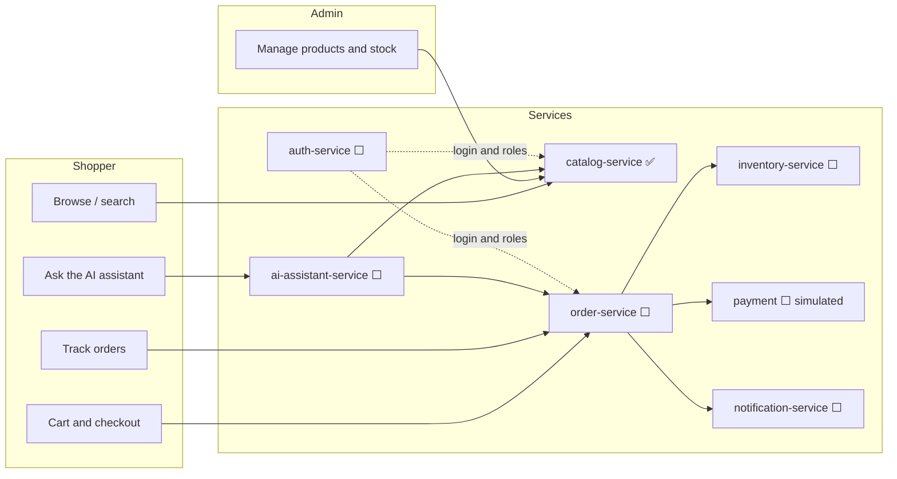
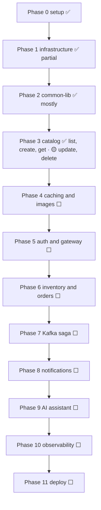
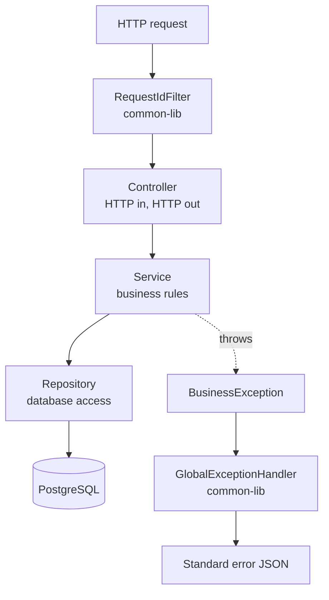
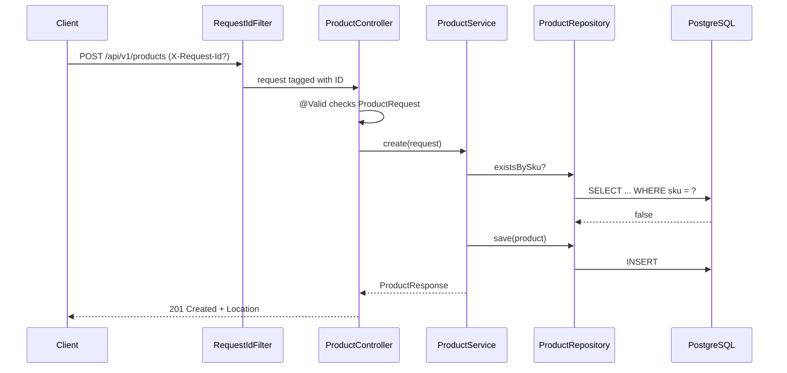
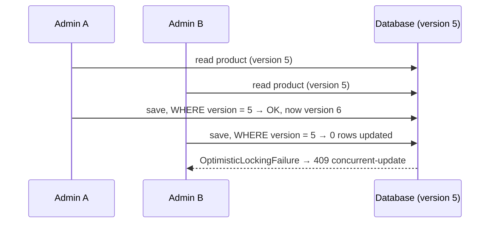

# Concepts and Reasons

This document explains **what we built, why each decision was made, and where to find it in the code**.
Read it alongside the code: each section names the file where the concept is used.

Status key: ✅ built and merged · 🟡 built, not yet merged · ⬜ planned

---

## 1. Feature scope

### 1.1 What the system is

An e-commerce platform for a single store, built as small services that talk through events.
Shoppers browse, search, buy and track orders. Admins manage the catalogue. An AI assistant answers shopping questions.

### 1.2 Scope in a diagram

### 1.3 Scope boundaries

| In scope | Out of scope (for now) |
|---|---|
| Product catalogue, search, admin editing | Real payments, shipping, tax, returns |
| Cart, checkout as a saga, order tracking | Multiple currencies and languages |
| Shopper and admin roles | Native mobile apps |
| AI assistant that answers from real data | Training our own AI model |

**Why draw the boundary?** A project without boundaries never finishes. Anything outside scope goes in a backlog, not into the current change.

### 1.4 Where each feature stands

---

## 2. Architecture

### 2.1 Layers inside one service

**Reason:** each layer has one job. You change a rule in the service, a URL in the controller, or a query in the repository, and the other layers stay untouched.

### 2.2 A request, step by step

**Failure path:** if `existsBySku` is true, the service throws `BusinessException`, and the handler returns 409 with the standard body. The controller never sees the error.

---

## 3. Concepts

Each concept follows the same pattern: **what**, **why**, **where**, **mistake to avoid**.

### 3.1 Layered architecture ✅
- **What:** controller → service → repository, with the entity and DTOs kept apart.
- **Why:** rules are testable without a web server, and storage can change without touching the API.
- **Where:** `catalog-service/.../controller`, `service`, `repository`.
- **Mistake to avoid:** putting `if` business rules in the controller, or SQL in the service.

### 3.2 DTO vs entity ✅
- **What:** the **entity** (`Product`) is the database row. The **DTO** (`ProductRequest`, `ProductResponse`) is the API shape.
- **Why:** the API can stay stable while the table changes. Internal fields such as `version` and `active` never leak to clients.
- **Where:** `domain/Product.java`, `dto/`.
- **Mistake to avoid:** returning the entity from a controller. A lazy-loaded relation then runs queries during JSON writing, and a new column is exposed without anyone deciding it should be.

### 3.3 Mapper ✅
- **What:** a class that converts between entity and DTO, in one place.
- **Why:** conversion rules (lower-case the category, upper-case the currency) live in one spot, not scattered.
- **Where:** `mapper/ProductMapper.java`.
- **Note:** MapStruct can generate this later. Write it by hand first so you understand what it generates.

### 3.4 Bean Validation ✅
- **What:** annotations such as `@NotBlank`, `@Size`, `@Pattern`, `@DecimalMin`, `@Digits` on the DTO fields. `@Valid` on the controller parameter runs them.
- **Why:** bad input is rejected before any business code or database call runs.
- **Where:** `dto/ProductRequest.java`, `controller/ProductController.java`.
- **Mistake to avoid:** validating only in the frontend. The backend must check again, because any client can send anything.

### 3.5 RFC 9457 Problem Details ✅
- **What:** a standard JSON shape for errors: `type`, `title`, `status`, `detail`, plus extra fields such as `errors`.
- **Why:** every service and client handles failures the same way. The `type` URL is for code; `title` and `detail` are for people.
- **Where:** `common-lib/.../error/GlobalExceptionHandler.java`, and the contract in `API_CONTRACT.md`.
- **Mistake to avoid:** returning a plain string like `"error"`. Clients then have to parse text, which breaks when the wording changes.

### 3.6 Global exception handling ✅
- **What:** `@RestControllerAdvice` with `@ExceptionHandler` methods. One class turns exceptions into responses for every controller.
- **Why:** the error format is decided in one place, and controllers stay free of `try/catch`.
- **Where:** `GlobalExceptionHandler.java`.
- **Mistake to avoid:** letting an exception escape without a handler. The default is a 500 with a body that leaks framework details.

### 3.7 Business exceptions ✅
- **What:** `BusinessException` carries a stable `slug`, an HTTP status, a title and a detail.
- **Why:** service code says "this is a 404" without knowing about HTTP. The slug is the code clients branch on.
- **Where:** `common-lib/.../error/BusinessException.java`.
- **Rule:** the slug is a public contract. Never rename it after release.

### 3.8 Request ID and MDC ✅
- **What:** each request gets an `X-Request-Id` (reused if safe, created otherwise). It is stored in MDC so every log line includes it.
- **Why:** one ID finds every log line of one request. Across services it becomes the thread that connects a whole checkout.
- **Where:** `common-lib/.../web/RequestIdFilter.java`.
- **Mistake to avoid:** forgetting `MDC.remove`. Servlet threads are reused, so the next request would log with the old ID.

### 3.9 Servlet filter and `OncePerRequestFilter` ✅
- **What:** a filter sits in front of the controllers and can read or change every request. `OncePerRequestFilter` guarantees it runs once even on internal forwards.
- **Why:** cross-cutting work (IDs, logging, security) belongs in one place, not in every controller.
- **Where:** `RequestIdFilter.java`.
- **Mistake to avoid:** doing slow or blocking work in a filter. It runs on every request.

### 3.10 Component scanning ✅
- **What:** Spring finds `@Component`, `@Service`, `@RestController` and similar classes by scanning packages.
- **Why:** shared code in `com.auramart.common` is registered only if the application scans that package.
- **Where:** `CatalogServiceApplication.java`: `scanBasePackages = {"com.auramart.catalog", "com.auramart.common"}`.
- **Mistake to avoid:** a handler in a package nobody scans. It silently does nothing, and errors come back as 500.

### 3.11 Constructor injection ✅
- **What:** dependencies are `final` fields passed through the constructor. Lombok's `@RequiredArgsConstructor` writes the constructor.
- **Why:** the dependency is required and visible, and a test can pass a fake without Spring.
- **Where:** `ProductController`, `ProductService`.
- **Mistake to avoid:** `@Autowired` on a field. It hides dependencies and makes tests harder.

### 3.12 Flyway migrations ✅
- **What:** SQL files named `V1__…`, `V2__…`, run once each, in order, and recorded in a table.
- **Why:** every environment gets the same schema. The history of the schema is in Git.
- **Where:** `catalog-service/src/main/resources/db/migration/`.
- **Rule:** **never edit a migration that has run.** Flyway stores a checksum; a changed file fails on every database that applied it. Add a new version instead. We did this with `V2`.

### 3.13 `ddl-auto = validate` ✅
- **What:** Hibernate checks that the table matches the entity, and never changes the schema.
- **Why:** two tools must not both change one schema. Flyway owns the schema.
- **Where:** `application.properties`.
- **Lesson:** this check found our `CHAR` vs `VARCHAR` mismatch at startup, which is exactly what it is for.

### 3.14 JPA entity and mapping ✅
- **What:** `@Entity`, `@Table`, `@Column` link a Java class to a table. `BigDecimal` is used for money.
- **Why:** `double` cannot represent 0.10 exactly, so money must use `BigDecimal`.
- **Where:** `domain/Product.java`.

### 3.15 Optimistic locking (`@Version`) ✅
- **What:** each row has a version number. A save succeeds only if the version in the database is still the one the save was built on. Otherwise the save fails.
- **Why:** two people editing the same product cannot silently overwrite each other.

- **Where:** `Product.java` (`@Version`), `GlobalExceptionHandler.handleOptimisticLock`.

### 3.16 `expectedUpdatedAt` (client-side check) 🟡
- **What:** the client sends the `updatedAt` it last read. If the product changed since, the update is refused.
- **Why:** it protects against stale edits from a user's screen, which the database version alone cannot see.
- **Difference from 3.15:** 3.15 catches two saves racing in the database. `expectedUpdatedAt` catches a user saving a copy from an old screen.
- **Where:** `ProductRequest.expectedUpdatedAt`, `ProductService.update`.

### 3.17 Transactions ✅
- **What:** `@Transactional` makes a method's database work all-or-nothing. Reads use `readOnly = true`.
- **Why:** half-saved data is worse than a clear failure. `readOnly` lets the database optimise reads.
- **Where:** `ProductService`.
- **Note:** JPA tracks managed entities and writes changes at commit. That is why `update` needs no explicit `save()`. This is called *dirty checking*.

### 3.18 Soft delete ✅ (🟡 for delete endpoint)
- **What:** `active = false` instead of removing the row.
- **Why:** orders can still refer to the product, history survives, and mistakes can be undone.
- **Where:** `Product.active`, `ProductService.delete`.

### 3.19 Paging and sorting ✅
- **What:** `page` (0-based), `size` (1 to 100), and `sort` from a whitelist of fields.
- **Why:** no request returns the whole table. The whitelist stops clients forcing slow sorts on unindexed columns.
- **Where:** `ProductController.list`, `PagedResponse`.

### 3.20 HTTP methods and status codes ✅
| Action | Method | Success | Common errors |
|---|---|---|---|
| Create | POST | 201 + Location | 400, 409 |
| Read one | GET | 200 | 404 |
| List | GET | 200 | 400 |
| Update | PUT | 200 | 400, 404, 409 |
| Delete (soft) | DELETE | 204 | 404 |

- **PUT is idempotent:** sending the same update twice leaves the same result.
- **Why 201 for create:** it says "something new exists", and `Location` says where.
- **Why 204 for delete:** the work is done and there is nothing to return.

### 3.21 Shared library (`common-lib`) ✅
- **What:** code every service needs: the error format, the request ID filter.
- **Why:** consistency across services without copying code.
- **Rule:** keep it small. Only put a class here if every service needs it.
- **Trade-off:** `spring-tx` was added to map the 409 conflict, so `common-lib` now depends on a Spring transaction package.

### 3.22 Maven multi-module ✅
- **What:** a parent `pom.xml` lists modules and sets versions once.
- **Why:** services cannot drift to different versions. One build compiles `common-lib` before the services that use it.
- **Where:** root `pom.xml`, each module's `pom.xml`.

### 3.23 Lombok ✅
- **What:** generates getters, setters and constructors at compile time.
- **Why:** less boilerplate to read. `optional` in the POM stops it being passed to services.
- **Requires:** annotation processing enabled in IntelliJ, or the editor shows false errors.

### 3.24 Docker Compose and healthchecks ✅
- **What:** four databases described in one file. Each has a healthcheck that proves it accepts connections.
- **Why:** one command builds the environment, and "running" is not the same as "ready".
- **Where:** `infra/docker-compose.yml`.
- **Lessons learned:**
  - Host ports can clash with software already on your laptop. We moved PostgreSQL to 5435.
  - Volumes keep data. `down -v` deletes it.
  - A changed password in `.env` does not change an existing database.

### 3.25 Secrets handling ✅
- **What:** passwords come from `infra/.env` and from environment variables. `.env` is git-ignored.
- **Why:** secrets must never reach GitHub. Config without a default fails loudly when a secret is missing.
- **Check:** `git check-ignore -v infra/.env`.

### 3.26 Git workflow ✅
- **What:** `main` is protected. One branch per change. Pull requests. Conventional Commits (`feat(...)`, `fix(...)`).
- **Why:** nothing reaches `main` without review, and history explains itself.
- **Mistake to avoid:** branching from a branch that is not merged. Always branch from `main`, and check `git log main..HEAD` before opening a pull request.

### 3.27 Testing layers ✅
| Layer | What it checks | Tool | Example |
|---|---|---|---|
| Unit | One class, dependencies faked | JUnit, Mockito | `ProductServiceTest` |
| Filter | HTTP-level rule without a server | Spring mocks | `RequestIdFilterTest` |
| Application | The app starts with a real database | Spring Boot test | `CatalogServiceApplicationTests` |
| Manual | The running service over HTTP | `curl` | list, update, delete checks |

⬜ Integration tests with Testcontainers are planned (step 3.10).

### 3.28 Observability (Actuator) 🟡
- **What:** `/actuator/health` reports whether the service is up and ready.
- **Why:** platforms and load balancers use it to restart or hold back traffic.
- **Rule:** expose only what you need. `env` and `beans` must stay closed.

---

## 4. Decision log (short)

| Decision | Reason | Alternative we rejected |
|---|---|---|
| Layers over one big class | Testable, changeable | Everything in the controller |
| PostgreSQL for search | Already holds the data; `pg_trgm` is built in | A separate search engine now (extra cost and sync) |
| Soft delete | History and undo | Hard delete |
| Two concurrency checks | Database race and stale screens are different problems | Only one of them |
| Manual mapper first | Learn what MapStruct generates | MapStruct from day one |
| Layer-first packages | Easy to read one feature | Feature-first (we will move when there are many features) |

---

## 5. Glossary

- **Entity:** a Java class mapped to a database table.
- **DTO:** a class shaped for the API, not for storage.
- **Repository:** the interface that reads and writes rows.
- **Migration:** a versioned SQL file that changes the schema once.
- **Idempotent:** doing the same operation twice gives the same result as doing it once.
- **Saga:** a sequence of steps across services with a way to undo earlier steps on failure.
- **MDC:** per-thread context that logs print automatically.
- **Healthcheck:** a test that proves a service is ready, not just running.
- **Slug:** the stable, machine-readable code for an error type.
